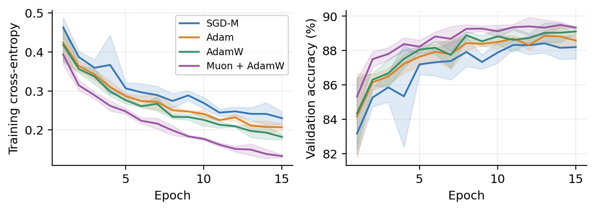
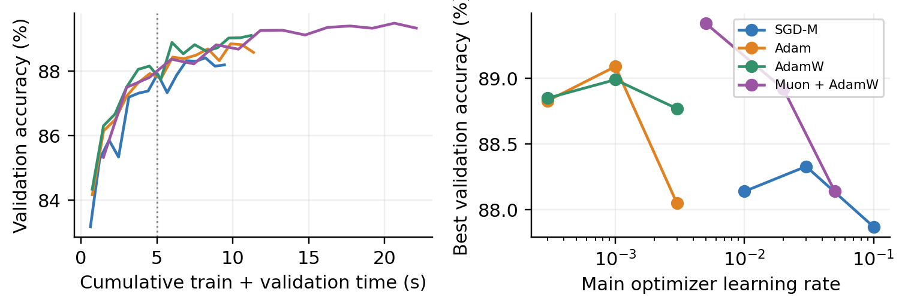

# CIE6007 Optimizer Benchmark

A reproducible comparison of momentum SGD, Adam, AdamW, and **Muon + auxiliary AdamW** on Fashion-MNIST. This is a small-model case study, not a claim that one optimizer is universally best.

[Paper preview (anonymous PDF)](submission/report_public.pdf) · [Development report](DEVELOPMENT_REPORT.md) · [Raw epoch data](results/metrics.csv) · [Summary](results/summary.csv)

## Measured results

One NVIDIA H200; 50,000 training / 10,000 validation / 10,000 official test examples; MLP 784–256–256–256–10; batch 128. Three ten-epoch learning-rate trials per optimizer, followed by three paired 15-epoch seeds. Values below are mean ± sample SD. Accuracy uses the validation-best checkpoint, never test-based selection.

| Optimizer | Selected LR | Test accuracy (%) | 15-epoch train time (s) |
|---|---:|---:|---:|
| SGD with momentum | 0.03 | 87.57 ± 0.32 | 9.40 ± 0.21 |
| Adam | 0.001 | 88.32 ± 0.40 | 11.31 ± 0.19 |
| AdamW | 0.001 | 88.59 ± 0.18 | 11.16 ± 0.08 |
| Muon + AdamW | 0.005 | 89.04 ± 0.29 | 22.04 ± 0.08 |

See `results/summary.csv` for full precision. Muon's mean test accuracy is 0.45 percentage points above AdamW, with 1.97× training time. At the predeclared five-second **cumulative training + validation** readout, test accuracy is 86.94%, 87.21%, 87.54%, and 87.18%, respectively. This retrospective, epoch-boundary readout excludes data loading, warmup, additional train-set evaluation and checkpoint I/O; it is not an independently deadline-stopped end-to-end run. With only three seeds, small differences are descriptive, not significance claims.




## Method and fairness

- Native, unmodified PyTorch 2.11 optimizers. No vendored Muon implementation or custom replacement.
- Muon updates **only** `body.0.weight` and `body.2.weight` (two 256×256 matrices, 39.1% of all parameters). Input projection, output head and every bias use AdamW at fixed LR 0.001. Muon momentum 0.95, Nesterov, five Newton–Schulz steps, original shape scaling. BF16 is internal to native Muon orthogonalization; model/gradient computations are FP32.
- SGD momentum 0.9; Adam and AdamW betas (0.9, 0.999), epsilon 1e-8. Matrix decay 1e-4; bias decay zero. SGD/Adam use coupled L2, AdamW/Muon use decoupled decay. Equal numerical decay does **not** match effective regularization.
- Fixed stratified split seed 2026; tuning seed 17; final seeds 101, 202, 303. Per-seed initialization hashes and CPU-generated minibatch orders are paired. Training reads no official test tensors.
- Three rates per method, ten epochs each, highest validation accuracy wins; tie by lower validation loss then lower LR. Final training lasts 15 epochs, with no schedule, augmentation or dropout. Muon's winning rate lies at the lower grid boundary; optimality outside this grid is unknown.
- Twenty disposable warmup updates; reinitialize model and optimizer afterward. CUDA synchronized at training/evaluation boundaries. All development tensors resident on GPU. No compilation, TF32 or AMP; `foreach=False` for conventional optimizers. Timings concern this implementation and tiny architecture.
- Jobs run sequentially in a deterministic shuffled order. GPU 0 was isolated from keep-alive jobs during measurements; other GPUs remained protected. Four-GPU keep-alive was restored after experiments.

## Reproduction

Python 3.12 was used; Python 3.11+ is compatible with the code if the pinned wheels are available. Create all environments/data/caches on your permitted storage. On this managed machine **all writes must remain under `/volume/yzhao04`**, and compute must execute on the paired GPU machine.

```bash
python3 -m venv .venv
source .venv/bin/activate
pip install torch==2.11.0 torchvision==0.26.0 --index-url https://download.pytorch.org/whl/cu130
pip install -r requirements.txt
python -c 'from src.data import download; download()'
python scripts/check_environment.py
PYTEST_DISABLE_PLUGIN_AUTOLOAD=1 python -m pytest -q
python scripts/run_all.py --phase smoke
python scripts/run_all.py
python scripts/evaluate_final.py
python scripts/plot_results.py
python scripts/validate_results.py
python scripts/generate_paper_results.py
bash scripts/build_paper.sh
```

Use the PyTorch CPU wheel index instead of `cu130` if no CUDA GPU is available. `run_all.py` detects CPU automatically, but its default full protocol can be slow: first use the smoke command or a short individual run. GPU times in this repository must not be presented as CPU results. To preserve the main experiment, run changed protocols in a fresh checkout/output tree.

Single optimizer:

```bash
python -m src.train --optimizer muon --lr 0.005 --seed 101 --epochs 15
```

Phases can be run separately with `--phase tune` and `--phase final`. Completed runs with all required checkpoints are skipped. A fresh clone contains historical CSVs but no checkpoints, so the same command retrains and regenerates its checkpoints. Interrupted partial runs restart from the beginning; no partially accumulated metrics are reused. Do not alter config/source and reuse old completed runs: reproduce in a fresh checkout or explicitly archive old `results/runs` and checkpoints first. `evaluate_final.py` requires the frozen training manifest. It evaluates only predeclared best, final, and five-second checkpoint choices.

The exact local environment reuses existing volume-resident CUDA packages through `.venv/lib/python3.12/site-packages/base_runtime.pth`; this avoids copying the large runtime and does not change the shared base environment. The clean installation above does not need that file. Key measured versions and the installed Muon source hash are in `results/environment.json`. The experiment's original source commit is `3a281c2`; each run records the full commit and SHA-256 of the source/configuration. Later commits add analysis and documentation.

### Paper build

Install Tectonic 0.15.0, then run `bash scripts/build_paper.sh`. It generates the local `submission/report.pdf` and anonymous `submission/report_public.pdf`. An offline TeX bundle can be passed through `TECTONIC_BUNDLE=/path/to/bundle.zip`; `TEX_ENGINE=/path/to/tectonic` selects the executable. All TeX temporary files stay in `paper/build`.

For the identified local submission, create **ignored** `paper/identity.tex`:

```tex
\renewcommand{\studentname}{Your Name}
\renewcommand{\studentnumber}{Your Student Number}
```

The public wrapper bypasses that file. Never commit the identified PDF or identity file. Only the local identified `report.pdf` is intended for Blackboard. The course deadline must be checked in Blackboard; this project does not submit to Blackboard automatically.

## Files and provenance

- `configs/experiment.yaml`: frozen protocol and candidate rates.
- `results/runs/*/metrics.csv`: original per-epoch records (smoke/tune/final explicitly tagged).
- `results/runs/*/completed.json`: run settings, initial hash, warmup time, commit/source hashes.
- `results/metrics.csv`: concatenation of all original rows (308 total).
- `results/selected_config.json`, `training_frozen.json`: validation selection and training freeze.
- `results/final_evaluations.csv`: 36 fixed-checkpoint evaluations and checkpoint SHA-256.
- `results/run_summary.csv`, `summary.csv`, `lr_sensitivity.csv`, `paired_differences.csv`: derived metrics.
- `results/figures/`: PNG and vector PDF figures; copied to `paper/figures` by plotting.
- `results/acceptance.json`: data audit; `tests/`: optimizer, repeatability, routing and leakage tests.
- `checkpoints/`, `data/`, `.venv/`, local logs and identified submission: deliberately ignored.

Raw model checkpoints are retained locally, not uploaded; retraining regenerates them. `validate_results.py` checks their hashes, so it should be run after a reproduction rather than against a checkpoint-free clone.

## Limitations and AI acknowledgement

Only one dataset, one data split, one small MLP, one tuning seed, three formal seeds and a short horizon were tested. The hybrid parameter routing, fixed auxiliary LR and regularization policy limit causal attribution to Muon itself. No energy efficiency, LLM performance or multi-GPU scaling claim is made.

OpenAI Codex substantially assisted experiment design, code, automated execution/checking, analysis, figures and report drafting. Context7 and primary-source retrieval supported API/reference checks. The saved experimental outputs are real; automated checks do not substitute for the student's understanding and review. See the paper's AI acknowledgement and references. Original project code is MIT licensed; upstream software/data retain their licenses.

## 中文说明

主实验、调参和测试评估均已真实运行，数字可以追溯到 CSV。正式结论是：本配置中 Muon 混合方案平均准确率较高，但耗时也更高；固定计算时间口径下的优势不同。开发记录见 `DEVELOPMENT_REPORT.md`。本地实名报告与公开匿名报告分开，学号、数据集、虚拟环境和模型权重不进入公开仓库。GitHub 已经用户确认后公开发布至 [XFDG/cie6007-optimizer-benchmark](https://github.com/XFDG/cie6007-optimizer-benchmark)；Blackboard 提交仍需另外完成。
